<div align="center">

# Práctica de Docker: ejecución de `biblioteca-api`

**Informe de práctica — Taller del 2do Corte (Parte 2)**

**Curso:** Arquitectura de Software
**Estudiante:** Sean Martinez
**Programa:** Ingeniería de Sistemas
**Docente:** Luis Carreño

</div>

---

## 1. Introducción y entorno

En esta práctica ejecuté en mi computador el proyecto **`biblioteca-api`** (API en Go + Gin + MySQL con arquitectura por capas) siguiendo la guía del `README.md` del repositorio, sin instalar Go ni MySQL: todo corre en contenedores. Cada fase tiene su evidencia y, al final, respondo las 5 preguntas de comprensión y describo los problemas que me encontré.

| Elemento | Valor |
|---|---|
| Sistema operativo | Windows 11 (versión 10.0.22621) |
| Terminal | `cmd` |
| Docker | 29.8.2 (build 7fc2dff) |
| Docker Compose | v5.6.0 |
| Git | 2.55.0.windows.5 |

**Resumen del proceso:** primero probé el proyecto descargado como ZIP y verifiqué Docker. Luego instalé Git, **cloné el repositorio con `git clone`** (paso 3.1 de la guía) en `Desktop\biblioteca-api` y repetí la puesta en marcha desde esa copia. Ahí me apareció un conflicto de puertos que resolví (problema 1), y durante la verificación en Swagger un error 401 (problema 2).

---

## 2. Fase 1 — Instalación y verificación de Docker

Comandos ejecutados y qué hace cada uno:

| Comando | ¿Qué hace? |
|---|---|
| `docker --version` | Muestra la versión del cliente de Docker; confirma que está instalado y en el `PATH`. |
| `docker compose version` | Muestra la versión del plugin Compose, que necesito para levantar varios servicios con un solo archivo. |
| `docker ps -a` | Lista **todos** los contenedores, incluso los detenidos; sirvió para ver el estado de la prueba inicial. |

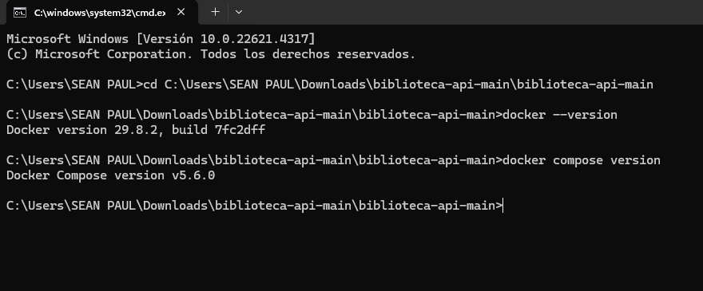

*Evidencia 1: Docker 29.8.2 y Docker Compose v5.6.0.*

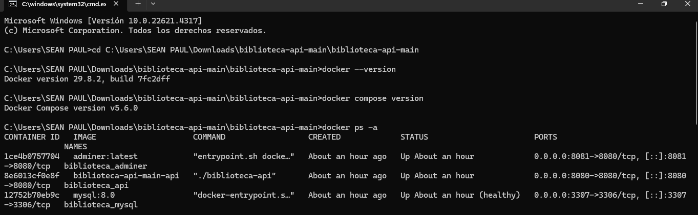

*Evidencia 2: en la prueba inicial (carpeta del ZIP) los tres contenedores llevaban una hora arriba y MySQL aparecía `healthy`.*

### Clonar el repositorio (paso 3.1)

```bash
git clone https://github.com/carrenoutb/biblioteca-api.git
cd biblioteca-api
```

`git clone` descarga una copia completa del repositorio (código e historial) en una carpeta nueva; luego `cd` entra en ella. Git no estaba instalado al inicio, así que lo instalé antes de clonar.

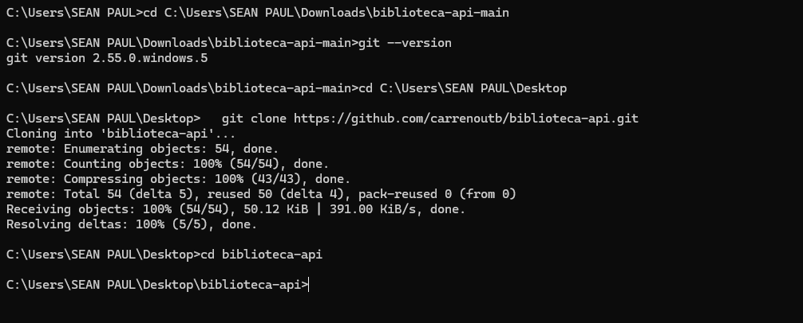

*Evidencia 3: clonado correcto (`Resolving deltas: 100%`) y ubicación en `Desktop\biblioteca-api`.*

---

## 3. Fase 2 — Puesta en marcha

### 3.1 Las piezas del proyecto

- **`Dockerfile`:** receta para construir la imagen de la API. Es *multi-stage*: una etapa `builder` parte de `golang:1.26-alpine`, copia `go.mod`/`go.sum`, descarga dependencias (`go mod download`), copia el código y compila el binario (`go build -o biblioteca-api ./cmd/api`); la etapa final solo copia ese binario y la carpeta `docs`. Así la imagen final no lleva el compilador de Go y pesa mucho menos.
- **`docker-compose.yml`:** describe los servicios del sistema y cómo se conectan: `mysql` (imagen `mysql:8.0` con *healthcheck* y volumen `mysql_data`), `api` (se construye con el Dockerfile y espera a que MySQL esté `healthy`) y `adminer` (interfaz web para ver la base de datos, en el puerto 8081).
- **`.env.example`:** plantilla de configuración con las variables que la API necesita. Se copia a `.env` para crear la configuración real.
- **`migrations/`:** scripts SQL que se montan en `/docker-entrypoint-initdb.d`; MySQL los ejecuta automáticamente la **primera vez** que inicia con el volumen vacío, creando las tablas (y, al parecer, los libros de ejemplo que luego aparecen en la API).

### 3.2 Crear la configuración

```cmd
copy .env.example .env
type .env
```

`copy` crea el `.env` a partir de la plantilla y `type` muestra su contenido.

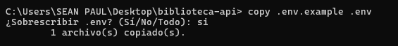

*Evidencia 4: el `.env` se creó a partir de la plantilla (aceptó sobrescribir uno previo).*

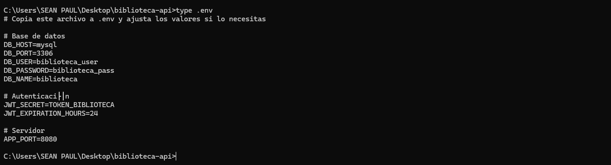

*Evidencia 5: contenido del `.env`.*

**Explicación de cada variable:**

| Variable | Valor | Función |
|---|---|---|
| `DB_HOST` | `mysql` | Nombre del servicio de MySQL en Compose. Dentro de la red de Docker, los contenedores se encuentran por ese nombre. |
| `DB_PORT` | `3306` | Puerto de MySQL **dentro** del contenedor (no el que expongo en mi PC). |
| `DB_USER` | `biblioteca_user` | Usuario con el que la API entra a la base de datos. |
| `DB_PASSWORD` | `biblioteca_pass` | Contraseña de ese usuario; debe coincidir con `MYSQL_PASSWORD` de MySQL. |
| `DB_NAME` | `biblioteca` | Nombre de la base de datos que usa la API. |
| `JWT_SECRET` | `TOKEN_BIBLIOTECA` | Clave con la que la API firma y verifica los tokens JWT de sesión. |
| `JWT_EXPIRATION_HOURS` | `24` | Horas que dura un token antes de expirar. |
| `APP_PORT` | `8080` | Puerto donde escucha la API dentro del contenedor. |

### 3.3 Levantar todo

```cmd
docker compose up --build -d
```

- `up`: crea (si hace falta) y arranca los servicios del `docker-compose.yml`, con su red y volúmenes.
- `--build`: reconstruye la imagen de la API antes de arrancar, para tomar el código y el Dockerfile actuales.
- `-d` (*detached*): ejecuta todo en segundo plano y devuelve la terminal. (La guía usa `docker compose up --build`; yo añadí `-d` para seguir usando la misma ventana.)

**Inicio (construcción).** En la primera ejecución desde la carpeta clonada, Docker descargó los metadatos de `golang:1.26-alpine` y construyó la imagen. Fragmento de la salida:

```text
[+] Building 34.1s (16/16) FINISHED
 => [builder 4/6] RUN go mod download                      12.7s
 => [builder 6/6] RUN go build -o biblioteca-api ./cmd/api 16.4s
 => => naming to docker.io/library/biblioteca-api-api:latest
 ✔ Image biblioteca-api-api         Built                  34.3s
 ✔ Network biblioteca-api_default   Created
 ✔ Volume biblioteca-api_mysql_data Created
```

**Final (servicios corriendo).** Tras resolver el conflicto de puertos (problema 1) lo volví a ejecutar:

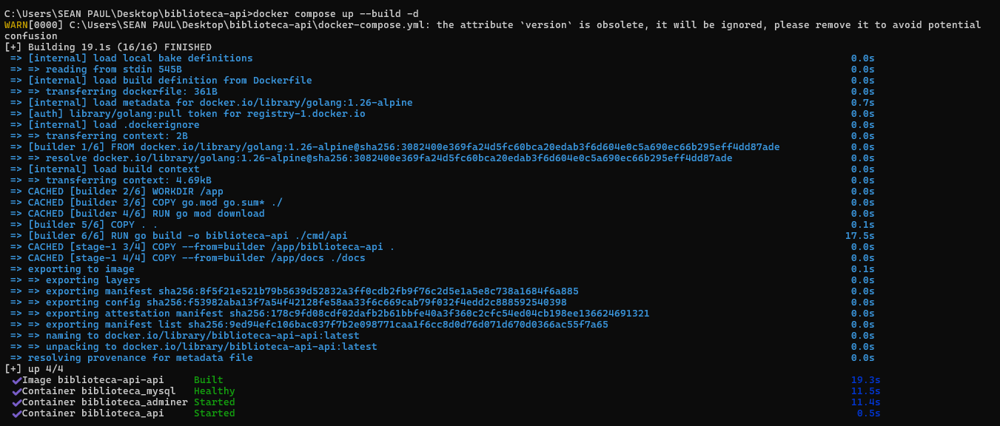

*Evidencia 6: imagen `Built`, MySQL `Healthy`, Adminer y API `Started`. Las capas aparecen como `CACHED` porque ya se habían construido antes, y solo se recompiló el binario.*

---

## 4. Fase 3 — Verificación

### 4.1 Estado de los servicios

```cmd
docker compose ps
```

Lista los contenedores del proyecto con su estado y puertos.

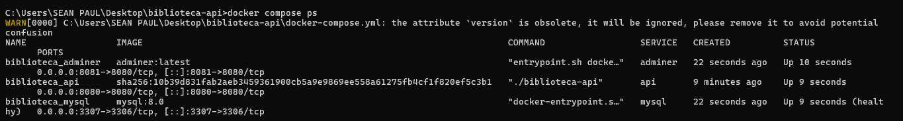

*Evidencia 7: los tres servicios `Up` y MySQL `healthy`. Puertos: API `8080→8080`, Adminer `8081→8080`, MySQL `3307→3306`.*

### 4.2 Swagger

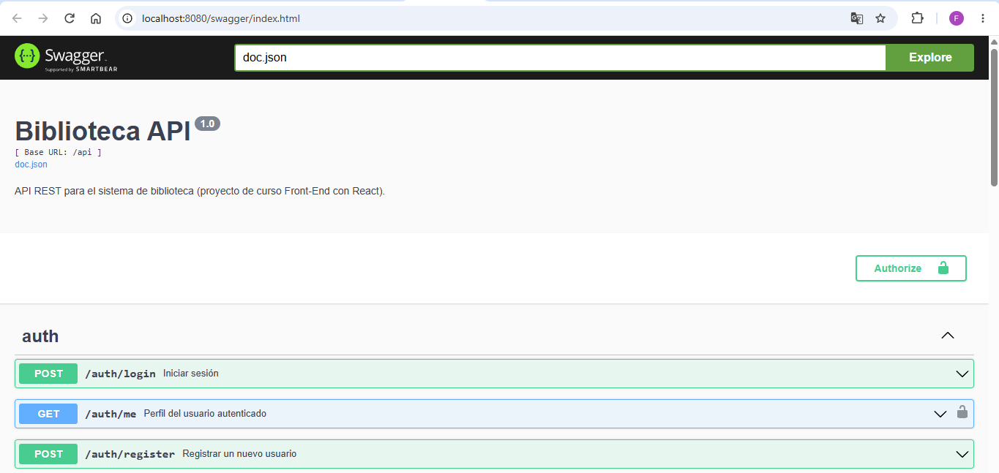

*Evidencia 8: Swagger respondiendo en `http://localhost:8080/swagger/index.html`, con los endpoints `/auth/login`, `/auth/me` y `/auth/register`.*

### 4.3 Flujo registrar → iniciar sesión → usar el token → listar libros

Usé Swagger UI. En cada paso, Swagger muestra el equivalente en `curl`.

**1) Registrar un usuario** — `POST /api/auth/register` con nombre, correo y contraseña. La API respondió **201 Created** con el usuario creado (rol `student`) y un token.

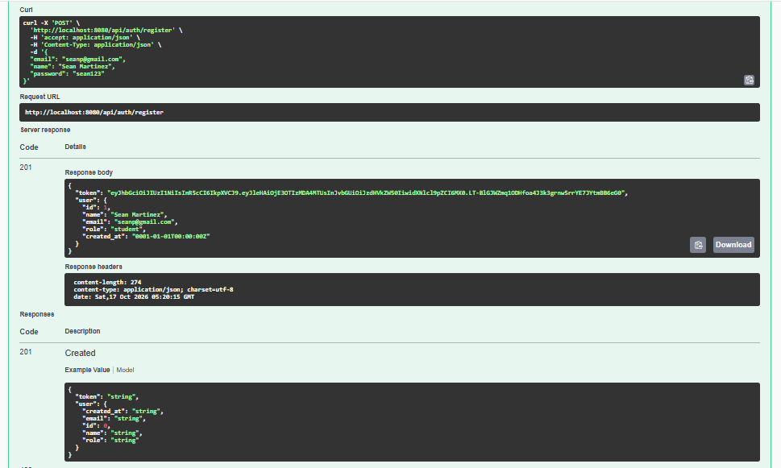

*Evidencia 9: registro exitoso (201).*

**2) Iniciar sesión** — `POST /api/auth/login` con el mismo correo y contraseña. Respondió **200 OK** y entregó el token JWT.

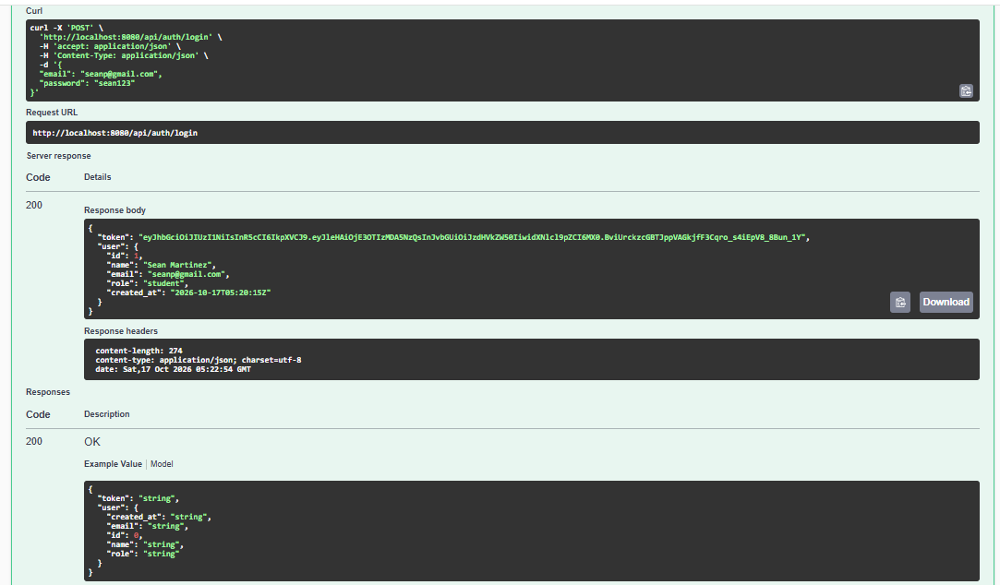

*Evidencia 10: login exitoso (200) con el token.*

**3) Usar el token** — En **Authorize** pegué `Bearer <token>` y consulté `GET /api/auth/me`, un endpoint protegido. Respondió **200** con el rol (`student`) y el `user_id` (1). (El primer intento falló con 401; ver problema 2.)

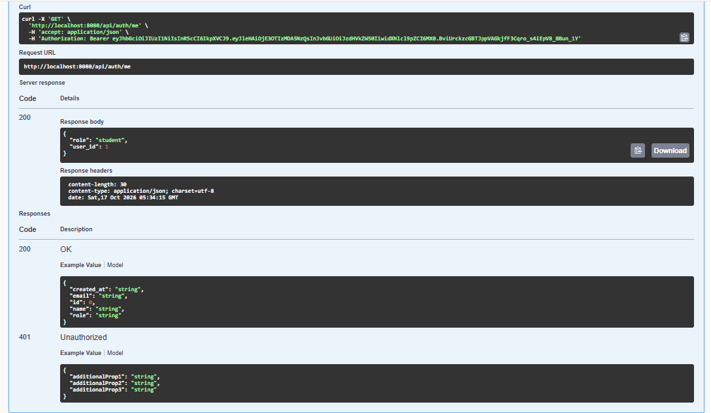

*Evidencia 11: endpoint protegido accesible con el token correcto.*

**4) Listar libros** — `GET /api/books` con la cabecera `Authorization: Bearer ...`. Respondió **200** con la lista de libros (*Cien años de soledad*, *Clean Code*, *El principito*…).

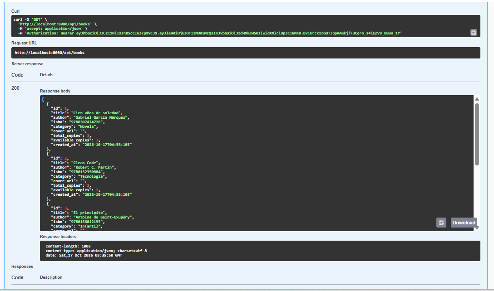

*Evidencia 12: listado de libros con el token.*

Con esto quedó comprobado que la API, la base de datos y la autenticación JWT funcionan de extremo a extremo dentro de los contenedores.

---

## 5. Problemas encontrados y cómo los resolví

### Problema 1 — Puerto 3306 ocupado

**Síntoma.** Al ejecutar `docker compose up --build` la imagen se construyó bien, pero MySQL no arrancó:

```text
Error response from daemon: ports are not available: exposing port TCP
0.0.0.0:3306 -> 127.0.0.1:0: listen tcp 0.0.0.0:3306: bind: Only one usage of
each socket address (protocol/network address/port) is normally permitted.
```

Después, `docker compose ps` salió vacío porque no quedó ningún servicio corriendo:

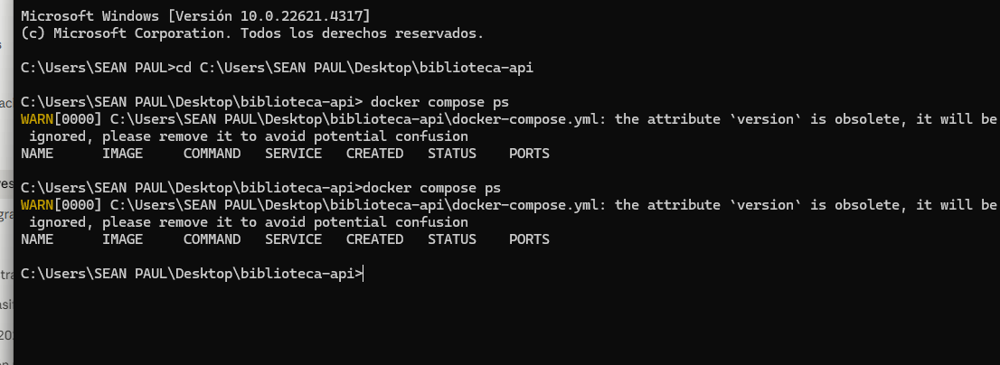

*Evidencia 13: ningún servicio activo tras el error.*

**Diagnóstico.** Con `netstat -ano | findstr :3306` vi que el proceso con PID 7044 ya estaba escuchando en los puertos 3306 y 33060 (los puertos típicos de un MySQL instalado directamente en Windows):

```text
TCP    0.0.0.0:3306     0.0.0.0:0   LISTENING   7044
TCP    0.0.0.0:33060    0.0.0.0:0   LISTENING   7044
TCP    [::]:3306        [::]:0      LISTENING   7044
TCP    [::]:33060       [::]:0      LISTENING   7044
```

**Solución.** Cambié el mapeo de puertos de MySQL en el `docker-compose.yml` de `"3306:3306"` a `"3307:3306"`. El primer número es el puerto de **mi computador** y el segundo el del **contenedor**: la API sigue conectándose por dentro con `DB_HOST=mysql` y `DB_PORT=3306`, y solo cambia el puerto por el que yo accedería a la base desde afuera (3307). Con eso levantó todo sin tocar el MySQL de Windows.

### Problema 2 — Error 401 "token no proporcionado"

**Síntoma.** Al consultar `GET /api/auth/me` tras copiar el token en Authorize, la API devolvió `401 Unauthorized` con `{"error": "token no proporcionado"}`.

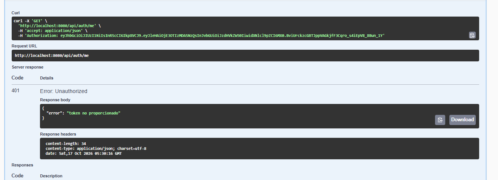

*Evidencia 14: en el `curl` la cabecera es `Authorization: eyJhbGci...`, sin la palabra `Bearer`.*

**Causa.** La API espera la cabecera en el formato `Authorization: Bearer <token>`. Yo pegué solo el token, así que no lo reconoció.

**Solución.** Abrí Authorize, cerré sesión para borrar el valor y escribí `Bearer ` (con espacio) antes del token. Después el mismo endpoint respondió 200 (Evidencia 11) y el `curl` ya mostraba `Authorization: Bearer ...`.

### Otros inconvenientes menores

- **`git` no se reconoce como comando:** Git no estaba instalado; lo instalé y abrí una terminal nueva para que Windows lo detectara.
- **Aviso `the attribute 'version' is obsolete`:** solo informativo; Compose ignora ese campo y no afecta el funcionamiento.

---

## 6. Preguntas de comprensión

### 1. ¿Qué diferencia hay entre una imagen y un contenedor? Ejemplo de este proyecto

La **imagen** es una plantilla de solo lectura, formada por capas, que contiene la aplicación y lo necesario para correrla; el **contenedor** es una instancia en ejecución de esa imagen. Es la cadena Dockerfile → imagen → contenedor que investigué en la Parte 1.

En este proyecto: con el `Dockerfile` y `docker compose up --build` se construyó la imagen **`biblioteca-api-api:latest`** (la salida dice `naming to docker.io/library/biblioteca-api-api:latest`). A partir de ella Compose arrancó el contenedor **`biblioteca_api`**. Lo mismo ocurre con `mysql:8.0` y `adminer:latest`: son imágenes descargadas de Docker Hub (el registro) y `biblioteca_mysql` y `biblioteca_adminer` son los contenedores creados desde ellas. De una misma imagen podría crear varios contenedores, y borrar un contenedor no borra su imagen.

### 2. ¿Qué hace `docker compose` que no harías con `docker run` por separado?

Con `docker run` levanto **un** contenedor y debo escribir a mano todas las opciones. Para este proyecto tendría que: crear la red, crear el volumen, construir la imagen, arrancar MySQL con sus variables, puertos y volúmenes, esperar yo mismo a que estuviera listo y recién entonces arrancar la API y Adminer, con los parámetros correctos y en el orden correcto.

`docker compose up` hace todo eso con **un solo comando** a partir del `docker-compose.yml`: crea la red `biblioteca-api_default` y el volumen `biblioteca-api_mysql_data` (se ven en la salida), construye la imagen, arranca los tres servicios y respeta las dependencias (`depends_on` con `condition: service_healthy`: la API espera a que MySQL esté `healthy`, como se ve en la evidencia 6). Además deja la configuración **escrita y versionable**, de modo que cualquier compañero obtiene exactamente el mismo entorno, que es la reproducibilidad de la que hablé en la Parte 1.

### 3. ¿Por qué la API encuentra la base de datos con `DB_HOST=mysql` y no con `127.0.0.1`?

Compose crea una red interna a la que se unen los contenedores, con un DNS propio que resuelve el **nombre de cada servicio** a la IP de su contenedor. Por eso `mysql` (el nombre del servicio en el `docker-compose.yml`) apunta al contenedor de MySQL.

`127.0.0.1` es la dirección de *loopback*, es decir, "esta misma máquina". Dentro del contenedor de la API, `127.0.0.1` es **el propio contenedor de la API**, donde no hay ningún MySQL escuchando, así que la conexión fallaría. Cada contenedor tiene su propio espacio de red aislado. Por la misma razón uso `DB_PORT=3306` (el puerto interno del contenedor) y no 3307, que es solo el puerto que publiqué en mi computador; desde mi PC sí entraría a la base por `localhost:3307`.

### 4. ¿Qué borra exactamente `docker compose down -v` y cuándo lo usaría?

`docker compose down` detiene y elimina los **contenedores** del proyecto y la **red** que Compose creó. Con **`-v`** además elimina los **volúmenes con nombre** declarados en el archivo, en este caso `mysql_data`, donde MySQL guarda la base de datos. **No** borra las imágenes (salvo que use `--rmi`), ni mis archivos locales (`.env`, el código, la carpeta `migrations/`).

Lo usaría cuando quiero **empezar desde cero**: por ejemplo, para que MySQL vuelva a ejecutar los scripts de `migrations/` (solo corren cuando el volumen está vacío) o cuando cambio credenciales de la base. Hay que tener cuidado, porque **se pierden todos los datos** (en mi caso, el usuario que registré). Por eso, para solo reiniciar, uso `down` sin `-v`, que conserva los datos.

### 5. ¿Qué pasaría si cambias `DB_PASSWORD` en el `.env` pero no en el `docker-compose.yml`? ¿Y al revés?

(Lo razono a partir de cómo funciona la configuración; no lo probé.) La API toma `DB_PASSWORD` del `.env`, y MySQL toma su contraseña de `MYSQL_PASSWORD` en el `docker-compose.yml`. **Ambas deben coincidir**.

- **Cambio solo el `.env`:** la API intentaría entrar con la contraseña nueva, pero el usuario de MySQL sigue con la anterior. MySQL rechazaría la conexión (*Access denied for user*), y la API no podría conectarse a la base de datos.
- **Cambio solo el `docker-compose.yml`:** MySQL usa `MYSQL_PASSWORD` únicamente cuando **inicializa un volumen vacío**. Si el volumen ya existe, el cambio se ignora y la contraseña real sigue siendo la vieja. Entonces: con volumen existente, la API (con el `.env` sin cambios) seguiría funcionando, pero la configuración quedaría desincronizada; con volumen nuevo (por ejemplo tras `down -v`), MySQL crearía el usuario con la contraseña nueva y la API, con la vieja del `.env`, recibiría el mismo error de acceso denegado.

En ambos casos, lo correcto es cambiar las dos y recrear el volumen con `docker compose down -v` si ya existía una base de datos.

---

## 7. Conclusión

La práctica me permitió ver en funcionamiento lo que investigué en la Parte 1: un Dockerfile que produce una imagen, contenedores que salen de ella, un registro del que se descargan `mysql` y `adminer`, y Compose coordinando todo. Lo que más aprendí fue de los errores: el conflicto del puerto 3306 me mostró la diferencia entre el puerto del computador y el del contenedor, y el 401 me enseñó que un token válido no sirve si la cabecera no tiene el formato `Bearer`. Al final, con un solo comando, se levantó una arquitectura de tres servicios sin instalar Go ni MySQL.

---

## 8. Índice de evidencias

| # | Archivo | Fase | Contenido |
|---|---|---|---|
| 1 | `01-docker-version.png` | 1 | `docker --version` y `docker compose version` |
| 2 | `02-docker-ps-a-prueba-inicial.png` | 1 | `docker ps -a` de la prueba inicial |
| 3 | `03-git-clone.png` | 1 | `git clone` del repositorio |
| 4 | `05-copy-env.png` | 2 | `copy .env.example .env` |
| 5 | `06-type-env.png` | 2 | Contenido del `.env` |
| 6 | `07-compose-up-build.png` | 2 | `docker compose up --build -d` |
| 7 | `08-compose-ps.png` | 3 | `docker compose ps` |
| 8 | `09-swagger.png` | 3 | Swagger UI |
| 9 | `10-register-201.png` | 3 | Registro (201) |
| 10 | `11-login-200.png` | 3 | Login (200) |
| 11 | `13-auth-me-200.png` | 3 | `/auth/me` con token (200) |
| 12 | `14-books-200.png` | 3 | Listado de libros (200) |
| 13 | `04-compose-ps-vacio-tras-error-puerto.png` | Problema 1 | Sin servicios tras el error de puerto |
| 14 | `12-error-401-sin-bearer.png` | Problema 2 | Error 401 sin `Bearer` |

---

## Referencias

1. Repositorio `biblioteca-api` y su `README.md` (guía de las secciones 0 a 3): https://github.com/carrenoutb/biblioteca-api
2. Docker Inc. (s. f.). *Docker Compose overview*. Docker Docs. https://docs.docker.com/compose/
3. Docker Inc. (s. f.). *Docker CLI reference*. Docker Docs. https://docs.docker.com/reference/cli/docker/
